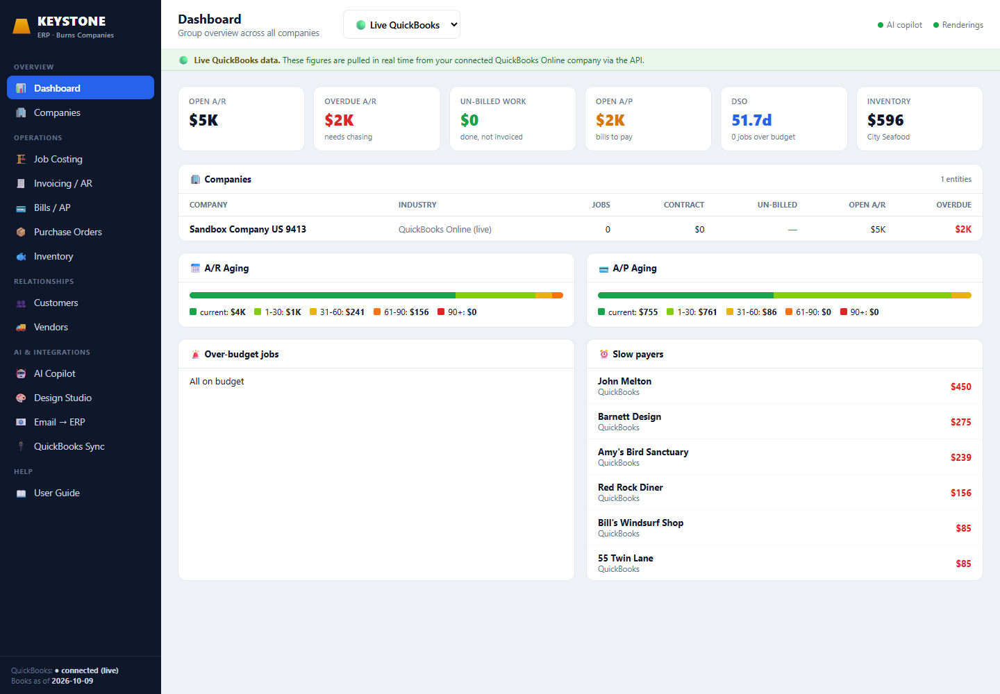

# KEYSTONE — an AI-native ERP with QuickBooks built in

**One system that runs a multi-company business — with a live QuickBooks connection, an AI copilot that never
fabricates a number, AI design renderings, and email-to-bill automation.**

Built as a working prototype for a real multi-company group (general contracting, hardscaping, pools,
graphics/signage, and wholesale/retail seafood) that runs on QuickBooks — the kind of business where job
costing and invoicing are still done by hand across separate company files.



## What it does
A full modular ERP in one screen, with a **Demo / Live QuickBooks** toggle:

**Operations:** multi-company **Dashboard** · **Job Costing** (budget vs actual) · **Invoicing / AR** (aging, DSO,
auto-generated progress invoices) · **Bills / AP** · **Purchase Orders** · **Inventory**
**Relationships:** **Customers (CRM)** · **Vendors**
**Multi-entity:** pull every number **per-company or consolidated as a group** from one switcher

## The AI & integration differentiators
- 🤖 **AI Copilot** — ask the books anything in plain English. Every figure is **computed deterministically in
  Python**; the LLM only narrates, so it **can't hallucinate a number.**
- 🎨 **Design Studio** — generate photorealistic pool/outdoor renderings, including **img2img on a client's
  actual backyard photo** (show them the pool before you build it).
- 📧 **Email → ERP** — AI reads a vendor-invoice email and extracts the vendor, amount, job, and GL account into
  a ready-to-post QuickBooks bill.
- 🔌 **Live QuickBooks Online integration** — full **OAuth2** connection; the operational modules render **real
  QuickBooks data** (invoices → AR, bills → AP, customers, vendors, items → inventory) when connected.

## Honest data model
- **Company profiles are real and publicly sourced.** Transaction dollars in *demo* mode are realistic-synthetic
  (the business is private; its financials aren't public) and are **clearly labeled** in the UI.
- Flip to **Live QuickBooks** and the numbers become real, pulled from the connected company via the API.

## Tech
**FastAPI** backend · deterministic analytics engine (`engine.py`) · **QuickBooks Online API** client with OAuth2
(`qbo.py`, `qbo_map.py`) · **Groq** (`gpt-oss-120b`) for the grounded copilot + email extraction · **OpenAI**
(`gpt-image-1`) for renderings · vanilla **HTML/CSS/JS** single-page UI. Runs locally at `http://127.0.0.1:8750`.

## Architecture
```
index.html  ── single-page ERP UI (13 modules, Demo/Live toggle, per-company switcher)
app.py      ── FastAPI: module endpoints, copilot, email-extract, render + render_edit, OAuth routes
engine.py   ── deterministic analytics (job costing, AR/AP aging, DSO, flags, drafts) — demo data
qbo.py      ── QuickBooks OAuth2 + API client (sandbox/production)
qbo_map.py  ── transforms live QuickBooks entities into the UI's shapes
generate_data.py ── realistic, Burns-modeled demo dataset (real profiles + synthetic transactions)
```

## Run it
**Windows:** double-click **`run.bat`** (installs deps, opens `http://127.0.0.1:8750`).
**Any OS:** `pip install fastapi "uvicorn[standard]"` then `uvicorn app:app --host 127.0.0.1 --port 8750`

**To connect QuickBooks:** copy `qbo_config.sample.json` → `qbo_config.json`, add your Intuit app's Client ID +
Secret, register `http://localhost:8750/qb/callback` as a redirect URI, then **QuickBooks Sync → Connect**.
*(`qbo_config.json` and `qbo_tokens.json` are gitignored — secrets never leave your machine.)*

## Author
**Leslie Moody** · [leslie-moody-ai.netlify.app](https://leslie-moody-ai.netlify.app) · [@lmoody68](https://github.com/lmoody68)

---
*Built in a single evening — from a sales call describing the problem to a working ERP with a live QuickBooks
connection. The lab became the product.*
